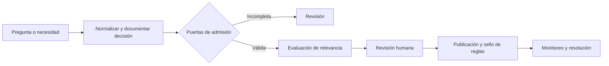

# 03 · PRAEV Relevance — curación por utilidad

## Objetivo

Identificar qué vale la pena pronosticar. Relevance mide la utilidad potencial de resolver una pregunta para un usuario y una decisión; no es probabilidad, precisión ni importancia universal. El mismo evento puede tener relevancia diferente para dos organizaciones.

## Admisión (puertas obligatorias)

Una pregunta debe tener: beneficiario específico; decisión posible antes del resultado; tiempo límite de actuación; resultado observable; fuente y criterio de resolución; fecha de cierre y horizonte; tratamiento de datos faltantes; consentimiento/legitimidad cuando corresponda. Rechazar contenido basado en apuestas, explotación de información privada, daño o ausencia de finalidad legítima. Si falta un criterio, estado `needs_revision`; no publicar con un score artificialmente alto.

## Modelo experimental

| Dimensión | 0 | 50 | 100 |
|---|---|---|---|
| Actionability | No hay acción posible | Acción indirecta o poco definida | Acción concreta antes de la resolución |
| Economic Exposure | Sin exposición identificada | Costos plausibles no cuantificados | Exposición significativa documentada |
| Human Impact | Sin afectados identificados | Grupo afectado definido | Consecuencias humanas relevantes respaldadas |
| Uncertainty | Respuesta conocida o trivial | Incertidumbre moderada | Incertidumbre material reducible con información |
| Resolvability | Sin resultado comprobable | Fuente con limitaciones | Fuente y criterio claros y auditables |

Propuesta inicial: `R = (A + E + H + U + V) / 5`. Mostrar 0–100 redondeado, componentes, evidencia, versión de rúbrica, evaluador y fecha. Si alguna dimensión es desconocida, marcar pendiente y evitar presentar una cifra definitiva. El score solo se calcula para preguntas que superen las puertas obligatorias. Umbrales experimentales: >=80 alta, 50–79 media, <50 baja. No automatizar rechazo por bajo impacto económico cuando hay impacto humano alto. Revisar ponderaciones con usuarios.

Ejemplo sintético: A=90, E=85, H=95, U=80, V=90 → 88/100. No equivale a 88% de probabilidad ni a una evaluación real de El Niño.

## Pipeline

El MVP usa formularios y rúbrica manual asistida; un LLM puede sugerir normalización y beneficiarios, pero no inventar datos, aprobar automáticamente ni resolver. La revisión conserva justificación. Categorías y tags se usan para especialización, búsqueda y métricas; el feed se ordena por utilidad y urgencia para el perfil, no por entretenimiento o volumen monetario.

## Registro de pregunta

`question_id`, `version`, `title`, `decision_context`, `beneficiaries`, `action_deadline`, `opens_at`, `commit_deadline`, `reveal_deadline`, `observation_window`, `resolution_deadline`, `outcomes`, `source_spec`, `missing_data_policy`, `domain`, `relevance_components`, `review_status`, `evidence_refs`, `rules_hash`.

Si cambia una regla material después de abrir, anular y crear una versión nueva; no alterar la pregunta sobre la cual alguien ya pronosticó. Publicar el motivo.

## Aceptación MVP

Un usuario puede proponer una pregunta, completar los campos mínimos, consultar el desglose y verla publicada por un revisor autorizado. Una pregunta inválida no pasa la admisión. El UI distingue relevancia, consenso y reputación. Conservar evidencia de al menos una pregunta admitida y una rechazada. Validar utilidad mediante entrevistas y no confundir evaluación editorial con un modelo probado.
