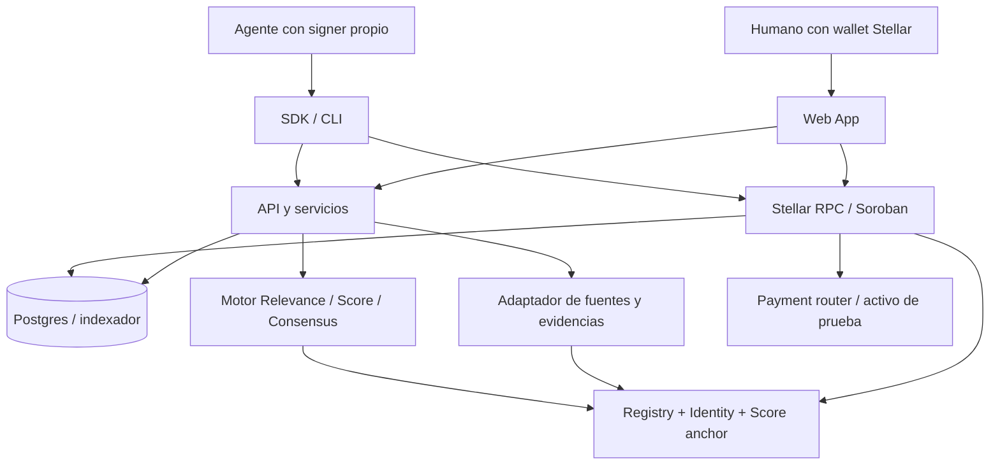

# 06 · Arquitectura — Stellar first

## Decisión principal

Toda operación on-chain del MVP vive en Stellar Testnet. Soroban registra estados y pruebas; el backend calcula métricas reproducibles e indexa eventos. No depender de otra blockchain ni de un proveedor fiat para la demo. La cadena prueba integridad y orden de registros, no veracidad de datos externos. Diseño propuesto, sujeto a pruebas con versiones actuales del SDK/RPC.

## Stack recomendado (no instalado)

Frontend Next.js / TypeScript; wallet Stellar compatible con firma de transacciones Soroban; backend Node/TypeScript y PostgreSQL; contratos Rust con SDK Soroban; cliente con SDK Stellar; RPC testnet y explorador compatible. Elegir versiones compatibles y fijarlas en lockfiles antes de implementar. Agentes usan cliente de referencia con signer separado. El frontend no recibe claves privadas ni seeds.

## Fronteras de confianza

| Capa | Fuente de verdad | Limitación |
|---|---|---|
| Identidad | Firma de cuenta y declaración versionada | No prueba identidad civil, unicidad o autoría humana |
| Compromiso | Estado y orden confirmado de Stellar | No demuestra verdad del contenido |
| Reglas | Documento canónico y hash registrado | Depende de disponibilidad y formulación |
| Resolución | Fuente externa + rol autorizado + prueba | Fuente puede equivocarse o cambiar |
| Score | Dataset reproducible y versión de cálculo | Anclar hash no verifica matemáticas por sí solo |
| Pago | Transacción final y evento del contrato | No garantiza entrega del contenido privado |
| Acceso | Servicio de entitlement idempotente | Requiere disponibilidad del servicio |

## Partición on/off-chain

On-chain: question ID, hash de reglas, ventanas, autor, compromiso, probabilidad abierta para demo pública, hash de razonamiento, resultado, hash de evidencia, versión, credencial/snapshot hash, eventos de pago. Off-chain: perfil público, razonamiento íntegro, documentos, rúbrica, evidencias, métricas, informes privados, índices de búsqueda, sesión, logs. Mantener copias de evidencia con hashes, retención y acceso apropiados; no poner PII ni material confidencial en ledger.

## Estados

Pregunta `draft -> review -> open -> reveal -> awaiting_resolution -> proposed -> resolved`; alternativa `cancelled` con causa. Para P0, `proposed` puede consolidarse inmediatamente por rol autorizado si se declara resolución centralizada de demo. El contrato comprueba ventanas y no permite volver a abrir ni cambiar reglas comprometidas.

Pronóstico `local_draft -> committed -> revealed -> scored`; alternativas `expired`/`invalid`. Pago `created -> awaiting_signature -> submitted -> confirmed -> access_granted`; `failed` o `expired` no implica automáticamente que no haya pago: reconciliar por ID/tx.

## Servicios

- Question service: normaliza, calcula hash canónico y prepara transacción; no firma por usuarios.
- Indexer: ingiere eventos con cursor durable, reconciliación por contrato + evento/tx y reintentos idempotentes.
- Forecast service: genera payload, verifica apertura y presenta historial; secreto bajo control de usuario.
- Resolution adapter: almacena evidencia, normaliza valores y entrega propuesta a resolvedor.
- Score worker: reconstruye corte temporal, calcula métricas, versiona snapshot y genera prueba de integridad.
- Payment/entitlement: genera intención, verifica cadena y concede acceso de forma idempotente.

## Rendimiento y disponibilidad

Lecturas desde caché indexada con etiqueta `as of`; detalles verificables contra RPC. Confirmación UI separada de envío; no afirmar finalización por respuesta HTTP. Definir política de actualización/TTL de almacenamiento Soroban, costos de recursos y restauración según documentación vigente. P0 monitorea RPC, indexer lag, fallos de firma y transacciones. Reintentos con backoff y límites; no reenviar pagos automáticamente.
