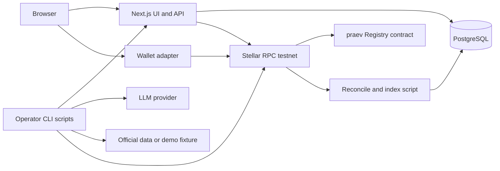

# Arquitectura monolito modular

**Estado:** P0 · **Versión:** 1.0 · **Fecha:** 2026-11-26

UI pública lee proyección SQL; chain es autoridad de existencia, timestamps y estados confirmados. DB conserva bytes, metadata, historial y receipts. No almacenar evidencia completa en chain. El script operador prepara spec, agente y resultado, firma con cuenta operativa separada y registra recepción. Browser firma solo acciones de usuario. Reconciliación explícita por tx y script periódico/manual; sin daemon obligatorio. RPC no lee HTTP externo desde contrato.

Módulos de dominio puros no dependen de Next, SDK o DB. Adaptadores encapsulan SQL, RPC, wallet y proveedor. Route Handlers validan y llaman servicios. UI no llama DB directamente. `server-only` en secretos y repositorios. El simulador de decisión se ejecuta local, no se envía a servidor. Mantener interfaces pequeñas, no microservicios.
