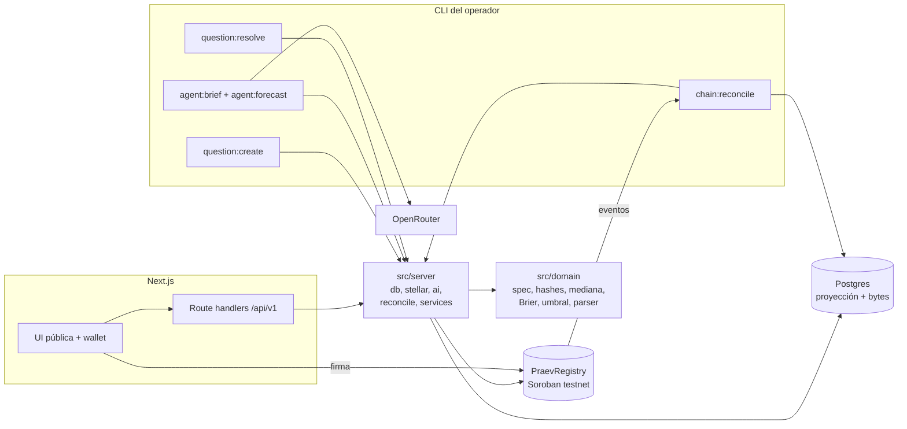

# Product backlog: épicas e historias de usuario

**Estado:** Vigente P0 · **Versión:** 1.1 · **Fecha:** 2026-11-26

Desglose del [backlog ejecutable](01-backlog.md) (B01–B15) en historias de usuario para trabajar en sprints. El plan de sprints, las ceremonias y la Definition of Ready/Done están en [06-scrum.md](06-scrum.md). Si una historia contradice un documento dueño (contrato, SQL, API, dominio), manda el documento dueño y se corrige la historia.

## 1. Cómo encaja la lógica

**Lógica de producto (ADR-024 a ADR-030):** un mercado de anticipación. Los **takers** proponen preguntas atadas a decisiones; los **makers** (personas reales, con un agente de IA como rival) arman una **tesis** con las herramientas de praev y la **sellan** en Stellar; al cierre se revela el consenso; la fuente oficial resuelve; el **perfil** de cada maker se recalcula. Las APIs de datos solo resuelven y alimentan el ancla.

praev es un monolito Next.js con cuatro capas y un contrato. La regla de oro: **la cadena es la autoridad** de lo que existe, cuándo y quién lo firmó; Postgres es una proyección y un almacén de bytes; el score y el consenso se **derivan** al leer, nunca se guardan editables.

| Capa | Qué contiene | Regla |
|---|---|---|
| `src/domain` | QuestionSpec y catálogo de categorías, tesis y compromiso, canonicalización y hashes, ancla, mediana, métricas del perfil, umbral de decisión, parser de observaciones | TypeScript puro, sin Next, SDK ni DB. Aquí viven los tests más importantes |
| `src/server` | Repositorios SQL, cliente Stellar y bindings, runner de IA, reconciliación, servicios | `server-only`. Los scripts CLI y las rutas API llaman a los mismos servicios |
| `src/app` | Páginas y route handlers | La UI nunca toca la DB; los handlers validan con Zod y delegan |
| `contracts/praev-registry` | Contrato Rust/Soroban | Autoriza, ordena en el tiempo y emite eventos; no calcula score ni lee HTTP |

### Los siete flujos

1. **Publicar una pregunta** (curador, CLI). Spec → validación Zod → bytes canónicos → `specHash` y `chainId = sha256(uuid)` → tx `create_question` → evento → reconciliación → fila `questions` en estado OPEN.
2. **Sellar una tesis** (maker, web). El maker arma la tesis con el ancla y el brief; el navegador genera la sal → `POST /forecasts/prepare` (el servidor valida, canonicaliza, calcula el compromiso, lee el `seq` siguiente de la cadena, guarda el payload oculto y un `tx_intent`, y simula) → el navegador recalcula el compromiso y lo compara → la wallet firma → `POST /transactions/submit` → polling → reconciliación → fila `forecasts` y recibo de sellado descargable.
3. **Brief y rival de IA** (operador, CLI). Spec + evidencia anterior al corte → `agent:brief` (resumen sin probabilidad, revisado y publicado) → `agent:forecast` con el mismo bundle → OpenRouter con `json_schema` estricto → Zod y comprobaciones cruzadas → revisión del operador → tesis sellada con la cuenta del agente → mismo camino de reconciliación.
4. **Resolver** (resolvedor, CLI). Evidencia permitida → parser → manifest → `evidenceHash` → preview y confirmación → tx `resolve` / `invalidate` → reconciliación → fila `resolutions`. A partir de aquí la mediana y el Brier se recalculan.
5. **Revelar al cierre** (automático). Cuando el tiempo del último ledger supera `closesAt`, la API empieza a devolver las tesis; se marca cada versión como `revealed`, `unrevealed` o `invalid` y aparece la mediana. Un maker puede revelar con su recibo (`POST /forecasts/reveal`).
6. **Proponer una pregunta** (taker, web). Formulario sin montos → firma `signMessage` → `POST /proposals` → el curador la revisa y, si la acepta, la publica con el flujo 1 y `requester` = taker.
7. **Verificar** (cualquiera, web). `/verify/[id]` descarga spec, evidencia y pronósticos → recalcula hashes en el navegador → consulta el contrato por RPC → muestra *coincide*, *no coincide* o *no disponible*.

El **Decision Register** vive solo en el navegador (localStorage + export JSON) y no toca el servidor en P0.

## 2. Convenciones

- **Formato:** *Como* rol, *quiero* capacidad, *para* beneficio. Los criterios de aceptación son verificables y enlazan a los IDs del blueprint (B = backlog, A = aceptación, T = tests).
- **Track:** `BE` backend/dominio, `SC` contrato Soroban, `FE` frontend, `OPS` infraestructura y operación, `QA` calidad y entrega.
- **Puntos:** Fibonacci (1, 2, 3, 5, 8). Ninguna historia supera 8; si crece, se divide.
- **Prioridad:** todo lo de este documento es P0 (*Must*) salvo la sección 4.
- **Roles:** visitante, maker (persona que pronostica), taker (quien propone la pregunta y decide), operador del agente, curador, resolvedor, verificador (un tercero o el jurado), desarrollador.

## 3. Épicas e historias

### EP0 · Fundaciones y entorno

| ID | Historia | Track | Pts | Sprint | Trazabilidad |
|---|---|---|---:|---|---|
| HU-01 | Como desarrollador, quiero un proyecto Next.js (App Router, TS estricto, Tailwind, `src/`) con lint, typecheck, test y build, para empezar sobre una base estable | OPS | 3 | S0 | B01, T28 |
| HU-02 | Como desarrollador, quiero el toolchain Stellar instalado y cuentas testnet separadas, para poder compilar y desplegar el contrato | OPS | 2 | S0 | B05, ADR-018 |
| HU-03 | Como desarrollador, quiero Postgres local y Neon remoto con un migrador versionado, para persistir la proyección | OPS | 2 | S0 | B01, B06 |
| HU-04 | Como verificador, quiero la app desplegada en Vercel desde el primer día con `/api/v1/health`, para comprobar que existe y responde | OPS | 2 | S0 | B01, ADR-019 |
| HU-05 | Como curador, quiero saber en 2 h como máximo si la estación SENAMHI de Chulucanas es utilizable, para decidir GO/NO-GO de la pregunta LIVE | BE | 3 | S0 | B02, A11, T27 |
| HU-06 | Como desarrollador, quiero CI que ejecute lint, typecheck, Vitest, build, `cargo test` y build del Wasm en cada push, para no romper `main` | OPS | 2 | S3 | T28, 08-quality/05 |
| HU-45 | Como curador, quiero validar el tipo de cambio diario de BCB (BR), TRM (CO) y BCRA (AR) además del BCRP, para abrir preguntas en varios países | BE | 2 | S1 | ADR-028, 05-data-sources |

**Criterios de aceptación**
- **HU-01:** `npm ci && npm run lint && npm run typecheck && npm test && npm run build` pasa en un clon limpio. El árbol sigue [04-repo](../03-architecture/04-repo.md). Existe `.env.example` con las variables de [06-env](../07-engineering/06-env.md). Las versiones reales quedan registradas.
- **HU-02:** `stellar --version` = 30.0.1; target `wasm32v1-none`; un contrato mínimo compila con el `soroban-sdk` fijado (30.0.0, o 28.0.0 si falla). Las cuentas `curator`, `resolver` y `agent` son distintas y tienen fondos; sus secretos viven solo en el keystore local.
- **HU-03:** `docker compose up -d db` y `npm run db:migrate` funcionan. El migrador ordena por número, guarda checksums y no aplica dos veces el mismo archivo. Neon creado con URL *pooled*.
- **HU-04:** URL pública en Vercel. `/api/v1/health` responde `{app, db, rpc}` sin secretos. El bundle público no contiene ninguna clave (grep).
- **HU-05:** muestra de 3 días con variable, unidad, intervalo, zona horaria, latencia, faltantes y licencia. URL exacta, timestamp y SHA-256 guardados. Decisión GO/NO-GO registrada como ADR. Si NO-GO: plan de contingencia de [02-vertical](../02-mvp/02-vertical.md) y bloqueo visible.
- **HU-06:** workflow verde en `main`, sin secretos operativos, con caché de lockfiles.
- **HU-45:** por fuente: muestra de 10 días hábiles con URL, fecha y SHA-256 en `fixtures/sources/`; latencia de publicación, tratamiento de feriados, decimales, revisiones y licencia; GO/NO-GO registrado en [05-data-sources](../07-engineering/05-data-sources.md). El BCRP es obligatorio; los otros tres, si no dan GO, quedan documentados y fuera.

### EP1 · Dominio de praev (`src/domain`)

| ID | Historia | Track | Pts | Sprint | Trazabilidad |
|---|---|---|---:|---|---|
| HU-07 | Como curador, quiero que una QuestionSpec v2 se valide (categoría habilitada, país ISO, tiempos ordenados, fuente, regla `sum`/`single`, umbral de referencia, relevancia), para que ninguna pregunta ambigua entre al sistema | BE | 5 | S1 | B03, 04-domain/01, 03 |
| HU-08 | Como verificador, quiero que spec, tesis y manifests se canonicalicen y hasheen igual en el servidor y en el navegador, y que la tesis se selle con sal, para recalcular pruebas sin confiar en praev | BE | 5 | S1 | B03, T12, T13, T29 |
| HU-09 | Como taker, quiero al cierre la mediana de las últimas tesis reveladas, la mediana humana y el ancla aparte, para decidir con un consenso independiente | BE | 3 | S2 | A04, T14, T31 |
| HU-10 | Como maker, quiero que mi Brier se calcule en enteros exactos solo sobre preguntas resueltas y separando LIVE de DEMO, para que mi historial sea justo | BE | 2 | S2 | A07, T15 |
| HU-11 | Como decisor, quiero que el umbral de acción p* = C/L se calcule exactamente, incluidos los casos borde, para no recibir una recomendación falsa | BE | 2 | S2 | T16, 04-domain/07 |
| HU-12 | Como resolvedor, quiero una regla genérica `sum`/`single` que invalide datos faltantes o solapados y aplique `>` estricto, para que un error de datos nunca se convierta en un NO | BE | 3 | S1 | T17, T35, 04-domain/09 |
| HU-46 | Como maker, quiero ver el ancla histórica de cada pregunta, calculada con la misma fuente y fijada antes del cierre, para partir de la frecuencia real | BE | 2 | S1 | ADR-025, 04-domain/06, T33 |

**Criterios de aceptación**
- **HU-07:** Zod rechaza tiempos desordenados, operador distinto de `gt`, floats, fuente vacía, resolver = curator, `relevance` sin justificación, categoría no habilitada, país no ISO y `single` con `missingPolicy` distinta de `invalidate`. DEMO exige URI `urn:praev:fixture:…`.
- **HU-08:** `commitment` del `ThesisPayload` con sal de 32 bytes; la misma tesis con otra sal da otro compromiso; sal no hex se rechaza. Vector `abc` = `ba7816bf…15ad`. `{"b":2,"a":1}` y `{"a":1,"b":2}` dan los mismos bytes. NFC normalizado; floats rechazados; `chainId = sha256(uuid)`. Alterar un byte cambia el hash. El mismo código corre en Node y en el navegador (Web Crypto).
- **HU-09:** antes del cierre devuelve `null` y solo el número de tesis selladas. Excluye `unrevealed` e `invalid`; si la última versión no se reveló, no usa la anterior. n = 0 → `null` (nunca 50 %). n par → promedio redondeado a bps con .5 hacia arriba. Usa solo la última versión confirmada por address; excluye resolver y baseline. Fixture: 7000/6000 → 6500; con A = 8000 → 7000.
- **HU-10:** `lossUnits = (bps − 10000·y)²`. Fixture YES: 9 000 000 y 16 000 000. INVALID/CANCELLED/pendientes no puntúan; n cuenta preguntas, no revisiones; n < 20 → provisional.
- **HU-11:** BigInt; L = 0 → N/D; C > L → umbral > 100 %; igualdad → indiferencia. Ejemplo C = 11 000, L = 20 000 → 55 %.
- **HU-12:** `single`: `n.d.` es faltante, dos valores el mismo día invalidan, igualdad con el umbral es NO. `sum`: fixtures de [04-fixtures](../08-quality/04-fixtures.md): 12+16 → YES; 10+15 = 25 → NO; faltante con suma parcial ≤ umbral → invalidar; faltante con suma parcial > umbral → YES (ADR-023); solape → invalidar; normaliza el ruido de coma flotante a 0,1 mm. Se prueba también con las muestras reales de `fixtures/sources/`.
- **HU-46:** método `anchor.v1` de [06-consensus](../04-domain/06-consensus.md) para `fx_daily` y `precipitation`; con menos de 30 ventanas, control 5000 bps etiquetado; se guarda en `baselines` con `sample_size` y evidencia al crear la pregunta.

### EP2 · Contrato `PraevRegistry`

| ID | Historia | Track | Pts | Sprint | Trazabilidad |
|---|---|---|---:|---|---|
| HU-13 | Como curador, quiero crear una pregunta on-chain con su hash de spec, tiempos, resolvedor y modo, para que nadie pueda modificarla después | SC | 5 | S1 | B04, A01, T01–T04 |
| HU-14 | Como maker, quiero sellar y versionar el compromiso de mi tesis solo antes del cierre, sin que nadie publique por mí, para demostrar qué creía antes del resultado sin que me copien | SC | 5 | S1 | B04, A02, A03, T05–T08, ADR-026 |
| HU-15 | Como resolvedor, quiero resolver o invalidar dentro de mi ventana con el hash de la evidencia (y el curador cancelar antes del cierre), con estado terminal inmutable | SC | 3 | S1 | B04, A06, T09–T11 |
| HU-16 | Como desarrollador, quiero eventos tipados con `#[contractevent]` y `extend_ttl` en cada escritura, para reconstruir el estado y que nada se archive durante la evaluación | SC | 2 | S1 | 06-stellar/03, ADR-020 |
| HU-17 | Como verificador, quiero el contrato desplegado en testnet con su ID, hash del Wasm y tx registrados, y los bindings TS generados, para comprobarlo en el explorador | SC | 3 | S1 | B05, A10 |

**Criterios de aceptación**
- **HU-13:** constructor con `curator`; `create_question` exige `curator.require_auth()`, resolver ≠ curator, tiempos ordenados, `now < closes_at`, modo válido y hash distinto de cero. Duplicado → `Exists`. Tests sin `mock_all_auths` indiscriminado.
- **HU-14:** `submit_forecast(id, forecaster, seq, commitment)`; `require_auth(forecaster)`; curator y resolver excluidos; `t == closes_at` → `Closed`; compromiso cero → `InvalidHash`; `seq` debe ser el siguiente exacto; `get_latest_seq` sin pronósticos devuelve 0. El contrato no recibe la probabilidad.
- **HU-15:** `resolve` solo en [resolveAfter, resolveBy] y con outcome 0/1; `invalidate` escribe `Resolution{outcome:2}`; `cancel` solo por curator antes del cierre y guarda el hash del motivo. Un segundo intento terminal falla.
- **HU-16:** eventos `q_created`, `forecast` (con compromiso, sin probabilidad), `resolved`, `invalid`, `cancelled` con test de decode; `extend_to` ≥ 518 400 ledgers.
- **HU-17:** `deployment.json` con contractId, network, wasmHash, deployTx y commit. Bindings con `npx @stellar/stellar-sdk generate`. Getters leídos por CLI. **Al cerrar esta historia se pide el hito "Stellar testnet" del Hub.**

### EP3 · Persistencia, API e indexación

| ID | Historia | Track | Pts | Sprint | Trazabilidad |
|---|---|---|---:|---|---|
| HU-18 | Como desarrollador, quiero la migración inicial y repositorios con consultas parametrizadas, para guardar la proyección y los bytes sin perder integridad | BE | 3 | S1 | B06, 07-engineering/01 |
| HU-19 | Como visitante, quiero que lo que ocurre en la cadena aparezca en la app, para ver datos confirmados y no promesas | BE | 5 | S1 | B08, T19 |
| HU-20 | Como visitante, quiero endpoints públicos de preguntas y pronósticos con errores en un formato estándar, para que la UI y terceros lean los datos | BE | 3 | S1 | 07-engineering/02, 03 |
| HU-21 | Como verificador, quiero endpoints de evidencia, prueba y makers, para descargar los bytes exactos y recalcular por mi cuenta | BE | 3 | S2 | 07-engineering/02 |
| HU-47 | Como maker, quiero que nadie vea mi tesis antes del cierre y que al cerrar se revele y se pueda comprobar contra mi compromiso, o revelarla yo con mi recibo, para competir sin que me copien | BE | 2 | S2 | ADR-026, A12, T30, T32 |

**Criterios de aceptación**
- **HU-18:** `001_initial.sql` aplicada según [01-database](../07-engineering/01-database.md) v1.1: `thesis_payloads`, `forecasts` con compromiso, `baselines` con `sample_size`, `question_proposals`, `cancel_reason_hash` y `ai_runs` con `kind`, `provider`, `adapter_version` y tokens. Se verifica el hash antes de insertar bytes. No existe tabla de score.
- **HU-19:** reconciliación por tx tras cada envío y script `chain:reconcile` con cursor real de `getEvents`. Repetir no duplica; un conflicto de payload alerta y no sobrescribe; si el cursor quedó fuera de la retención (≈7 días) marca GAP. Se ejecuta al menos una vez al día.
- **HU-20:** `GET /questions`, `/questions/{id}`, `/questions/{id}/forecasts`, `/health`. Filtros con allowlist, `limit` 1–50, cursor opaco. Envelope de error con `code`, `message`, `requestId` y `retryable`.
- **HU-21:** `GET /questions/{id}/evidence`, `/evidence/{id}/content` (bytes exactos, MIME seguro), `/makers`, `/proof/{id}` (spec en base64, chainId, contrato, hashes, receipts, manifest).
- **HU-47:** un único repositorio filtra `thesis_payloads` por el tiempo del último ledger y lo usan todas las rutas públicas (T30); al cerrar, cada versión queda `revealed`, `unrevealed` o `invalid`; `POST /forecasts/reveal` acepta un recibo solo tras el cierre y si el hash coincide (T32); los logs nunca contienen payloads.

### EP4 · Operación: curaduría, evidencia y resolución

| ID | Historia | Track | Pts | Sprint | Trazabilidad |
|---|---|---|---:|---|---|
| HU-22 | Como curador, quiero un comando que valide la spec, calcule hashes y el ancla, cree la pregunta on-chain y la registre, para publicar preguntas sin panel de administración | BE | 3 | S1 | B07, A01 |
| HU-23 | Como presentador de la demo, quiero sembrar una pregunta DEMO con ventanas reales cortas y fixtures etiquetados, para tener un ciclo resoluble en testnet | BE | 2 | S1 | B07, 02-mvp/03 |
| HU-24 | Como resolvedor, quiero un comando que cargue la evidencia, construya el manifest, me muestre un preview y firme tras mi confirmación, para resolver de forma auditable | BE | 5 | S1 | B07, A06 |
| HU-44 | Como resolvedor, quiero adaptadores de series para SENAMHI y BCRP (y los países con GO de HU-45) detrás de la misma interfaz, para resolver cualquier pregunta con una sola tubería | BE | 3 | S1 | ADR-028, 05-data-sources |
| HU-25 | Como curador, quiero publicar las preguntas LIVE (tipo de cambio de cada día hábil y la lluvia de Chulucanas) antes de su cierre, para acumular resoluciones reales | BE | 3 | S1 (29 nov) | A11, A15, 02-mvp/02 |

**Criterios de aceptación**
- **HU-22:** `npm run question:create -- <spec.json>` falla con exit ≠ 0 si falta un parámetro o variable; guarda `spec_bytes` exactos; fija el ancla (HU-46); espera SUCCESS y reconcilia. `npm run question:fx -- --date <D>` genera la spec desde la plantilla de [12-categories](../04-domain/12-categories.md).
- **HU-23:** `npm run demo:seed` crea una pregunta con cierre a +15 min y observación de 120 s; todos los registros dicen "Simulación técnica, no observación oficial". Se prepara además una instancia ya resuelta para la grabación.
- **HU-24:** comprueba `t ≥ resolveAfter` en el ledger; muestra suma, umbral, outcome, fuente y hash; pide confirmación; simula, firma y espera SUCCESS. Sin datos suficientes espera o invalida; nunca improvisa una fuente. Además resuelve en lote las preguntas `fx_daily` vencidas, con un manifest por pregunta.
- **HU-44:** `ObservationAdapter` por fuente con fetch HTTPS allowlisted y bytes guardados con SHA-256; tests con las muestras reales; `n.d.` → faltante.
- **HU-25:** lluvia solo con GO de HU-05, publicada **antes del 30 nov a medianoche** (ventana 1–4 dic). Tipo de cambio: desde el 29 nov, preguntas para cada día hábil del 30 nov al 3 dic por país con GO, con al menos 20 resoluciones esperadas antes del 4 dic. Una pregunta LIVE puede seguir abierta al entregar.

### EP5 · Radar y detalle de pregunta

| ID | Historia | Track | Pts | Sprint | Trazabilidad |
|---|---|---|---:|---|---|
| HU-26 | Como visitante, quiero una interfaz sobria con el sistema visual de praev, usable en móvil y con teclado, para leer sin fricción | FE | 3 | S1 | 01-product/03, 04, 08 |
| HU-27 | Como visitante, quiero un Radar con las preguntas, filtros y la etiqueta DEMO siempre visible, para entender en 20 segundos qué merece atención | FE | 3 | S1 | B09, A09, 01-product/05 |
| HU-28 | Como visitante, quiero el detalle de una pregunta con estado, tesis selladas o consenso revelado, ancla, gráfico de la serie, brief, regla, fuente, quién la propuso y resultado, para evaluarla por mi cuenta | FE | 5 | S2 | B09, 01-product/06 |
| HU-29 | Como visitante, quiero una página de metodología, para entender cómo se elige, pronostica y resuelve, y sus límites | FE | 1 | S3 | 01-product/03 |

**Criterios de aceptación**
- **HU-26:** tokens de color, Inter o fuente del sistema con números tabulares, header con `praev.`, Radar, Makers, Proponer, Metodología, indicador Testnet y botón de wallet; footer con disclaimer. Contraste AA comprobado, foco visible, 360 px y zoom 200 %.
- **HU-27:** tarjeta con pregunta, categoría, país, cierre en PET, relevancia, "N tesis selladas" antes del cierre o consenso después, fuente y CTA. Filtros LIVE/DEMO/todos, categoría y estado. Sin wallet. Nunca muestra 50 % si no hay pronósticos.
- **HU-28:** estados OPEN (selladas, cuenta regresiva al revelado), CLOSED (tesis reveladas, consenso y mediana humana), RESOLVED (outcome y Brier) e INVALID (motivo). Tesis con autor, tipo, versión, hora, estado y enlace a la tx. Evidencia no disponible se indica. Sin botón de compra ni apuesta.
- **HU-29:** texto en español, enlazado desde el header y el footer.

### EP6 · Maker humano: tesis sellada con wallet

| ID | Historia | Track | Pts | Sprint | Trazabilidad |
|---|---|---|---:|---|---|
| HU-30 | Como maker, quiero conectar mi wallet y ver mi cuenta y la red, para saber con qué identidad voy a firmar | FE | 2 | S2 | B10, 06-stellar/05 |
| HU-31 | Como maker, quiero firmar el compromiso de mi tesis con mi wallet y que el servidor solo acepte la transacción que preparó, para sellarla en Stellar | BE+FE | 5 | S2 | B10, A02, A03, T20, T21 |
| HU-48 | Como maker, quiero armar mi tesis (probabilidad, ancla, factores, evidencia, qué me haría cambiar de opinión) y descargar mi recibo de sellado, para fundamentar mi pronóstico y poder probarlo | FE | 5 | S2 | ADR-025, 04-domain/04 |
| HU-51 | Como Product Owner, quiero invitar makers reales y darles una guía corta, para que el perfil y el consenso tengan personas detrás y no solo al equipo | OPS | 2 | S2 | ADR-024 |
| HU-32 | Como maker, quiero ver el estado real de mi transacción y conservar mi borrador si algo falla, para no perder trabajo ni creer en un éxito falso | FE | 3 | S2 | B10, T23 |

**Criterios de aceptación**
- **HU-30:** Stellar Wallets Kit 2.8.0 con Varial/Freighter; muestra cuenta y Testnet; rechaza mainnet en UI, API y scripts. Conectar no crea sesión en el servidor.
- **HU-31:** `POST /forecasts/prepare` recibe el `ThesisPayload`, valida, calcula el compromiso y `seq`, guarda el payload oculto, simula y guarda el intent; el navegador recalcula el compromiso y no firma si difiere; `POST /transactions/submit` rechaza XDR alterado, otra red u operaciones extra, y un reenvío idéntico devuelve el estado existente.
- **HU-48:** slider y campo numérico sincronizados, convertidos a bps con validación; ancla prellenada y editable; hasta 3 factores ↑/↓ con sugerencias por subcategoría; evidencia del brief o URL HTTPS; contador de completitud; sal con Web Crypto; aviso "Tu tesis quedará sellada hasta el cierre; luego será pública junto a tu dirección en Stellar"; recibo en `praev.sealed.v1` y descarga JSON.
- **HU-51:** guía de una página para makers, invitación a al menos 5 personas reales (comunidad del Hub, conocidos) con wallet testnet fondeada, y registro de cuántas tesis sellaron.
- **HU-32:** estados idle → signing → submitted → confirming → confirmed / failed / unknown, anunciados en una live region. `NOT_FOUND` durante el polling no es un fallo. El rechazo de la firma conserva el borrador; `bad_seq` re-prepara sin cambiar p.

### EP7 · Agente de IA: brief y rival

| ID | Historia | Track | Pts | Sprint | Trazabilidad |
|---|---|---|---:|---|---|
| HU-33 | Como maker, quiero competir contra un rival de IA que sella su propia tesis con evidencia anterior al corte, para saber si mi juicio aporta más que una máquina | BE | 5 | S2 | B11, 05-ai/01–03, T18, ADR-027 |
| HU-34 | Como operador, quiero revisar el resultado y que el agente firme con su propia cuenta, registrando modelo, proveedor y versión, para que su historial sea auditable | BE | 3 | S2 | B11, A02, 04-domain/11 |
| HU-49 | Como maker, quiero un brief de evidencia por pregunta, igual para todos y sin probabilidad sugerida, para investigar más rápido sin que la IA piense por mí | BE | 3 | S2 | ADR-027, 05-ai/02 |

**Criterios de aceptación**
- **HU-33:** salida `ThesisOutput` convertida en `ThesisPayload` sellado; `text.format` `json_schema` estricto con `provider.require_parameters: true`; Zod valida el esquema; IDs de evidencia inventados, refusal, salida incompleta o mezcla de abstención con número → no se firma. Timeout de 45 s y un solo reintento. El outcome nunca llega al prompt.
- **HU-34:** confirmación explícita antes de firmar; el LLM no tiene acceso a la clave. `ai_runs` guarda el modelo y el proveedor que devolvió OpenRouter, `promptVersion`, `cutoff` y tokens. Un fixture **no** satisface A02.
- **HU-49:** `npm run agent:brief -- <questionId>` produce `EvidenceBrief` validado; se rechaza si contiene una probabilidad; el operador lo revisa y publica; se genera antes del rival y con el mismo bundle; se muestra en el detalle y en el formulario de tesis.

### EP8 · Lado taker: propuesta y Decision Register

| ID | Historia | Track | Pts | Sprint | Trazabilidad |
|---|---|---|---:|---|---|
| HU-50 | Como taker, quiero proponer una pregunta con mi contexto de decisión, fecha límite y umbral de referencia, firmada con mi wallet, para que los makers pronostiquen lo que necesito decidir | BE+FE | 3 | S2 | ADR-030, A14, T36 |
| HU-35 | Como taker, quiero introducir el coste de actuar y la pérdida evitable y ver si la probabilidad cruza mi umbral, para saber si conviene revisar una alternativa | FE | 3 | S2 | B12, 04-domain/07 |
| HU-36 | Como taker, quiero guardar mi decisión con la probabilidad de ese momento, exportarla y revisarla cuando se resuelva la pregunta, para aprender de mis decisiones | FE | 3 | S2 | B12, A05, T24 |

**Criterios de aceptación**
- **HU-50:** formulario en `/proponer` sin montos; propuesta canónica firmada con `signMessage` de Wallets Kit; `POST /proposals` verifica la firma y la dirección; `npm run proposals:list` para el curador; al publicar, `requester` queda en la spec.
- **HU-35:** usa HU-11; valores en centavos enteros; mensaje "Se alcanzó el umbral definido por ti: revisa la alternativa"; nunca una instrucción automática.
- **HU-36:** snapshot inmutable en `praev.demo.decisions.v1` (máximo 50, sin PII); cambiar el consenso no reescribe el snapshot; export JSON, borrado explícito; al resolverse muestra probabilidad al decidir, acción, resultado, Brier y "resultado operativo no medido".

### EP9 · Reputación y verificación pública

| ID | Historia | Track | Pts | Sprint | Trazabilidad |
|---|---|---|---:|---|---|
| HU-43 | Como taker, quiero las métricas de cada maker (Brier, skill frente al ancla, acierto, calibración, frente al consenso, frente a la IA y P&L de decisión), para saber a quién creerle | BE | 5 | S2 | ADR-029, 04-domain/10, A13, T34 |
| HU-37 | Como taker, quiero la lista de makers y el perfil de cada uno al estilo de un historial de trader, filtrable por categoría y horizonte, para elegir en quién confiar | FE | 5 | S2 | B13, 01-product/07 |
| HU-38 | Como verificador, quiero recalcular en mi navegador los hashes de una pregunta y compararlos con el contrato, para comprobar la prueba sin confiar en praev | FE | 5 | S2 | B13, A08, T26 |

**Criterios de aceptación**
- **HU-43:** funciones puras en `src/domain` con los ejemplos exactos de [10-reputation](../04-domain/10-reputation.md); consenso *leave-one-out*; P&L de decisión solo con `referenceThresholdBps`; cohortes por modo, categoría y horizonte.
- **HU-37:** LIVE y DEMO separados por defecto; n = 0 → "Sin historial"; n < 20 → "Provisional", sin ranking ni calibración; P&L con la etiqueta "hipotético"; historial con enlaces a Stellar Expert.
- **HU-38:** descarga spec, evidencia y pronósticos; recalcula con el mismo canonicalizador de HU-08; consulta el contrato por RPC. Tres resultados posibles: coincide, no coincide, no disponible. Otro contrato o historial fuera de retención no se dan por válidos.

### EP10 · Calidad, release y demo

| ID | Historia | Track | Pts | Sprint | Trazabilidad |
|---|---|---|---:|---|---|
| HU-39 | Como desarrollador, quiero los controles de seguridad básicos, para que la app pública no sea fácil de abusar | BE | 3 | S3 | 08-quality/01, 05 |
| HU-40 | Como verificador, quiero un ciclo real completo en testnet documentado con su matriz de pruebas, para confiar en que funciona | QA | 5 | S3 | B14, T22–T25 |
| HU-41 | Como verificador, quiero un README final con la evidencia y las instrucciones de ejecución, para reproducir praev desde un clon limpio | QA | 2 | S3 | B15, A10 |
| HU-42 | Como jurado, quiero un video de 3 minutos como máximo y la entrega en APEX confirmada, para evaluar praev | QA | 3 | S3 | B15, 09-execution/03 |

**Criterios de aceptación**
- **HU-39:** rate limit en prepare y submit (≈10/min por IP o address, en DB o en el hosting); CSP; allowlist HTTPS contra SSRF; límites de payload; logs estructurados sin XDR completos, prompts ni secretos.
- **HU-40:** dos direcciones humanas y el agente rival sellan tesis, se revelan al cierre; la pregunta DEMO se resuelve; el Brier y el verificador cuadran. Matriz T01–T28 con PASS/FAIL/NOT RUN y comando, fecha y commit.
- **HU-41:** README con contract ID, tx de create/forecast/resolve, URL de la app, comandos y limitaciones; `release-evidence.md` completo.
- **HU-42:** video según el guion, en YouTube no listado, Drive o Loom; enlaces probados sin sesión; TTL renovado el 4 dic; recepción en APEX confirmada antes de las 18:00.

## 4. Fuera de P0 (no entra en ningún sprint)

| Épica futura | Origen |
|---|---|
| Pago fijo del taker repartido entre makers por reputación previa (USDC testnet, sin custodia) | ADR-011, ADR-030, 06-stellar/07 |
| Macrocategorías adicionales (9 del mapa) | ADR-028, 04-domain/12 |
| Varios agentes makers independientes | ADR-027 |
| Consenso ponderado por reputación con validación fuera de muestra | 04-domain/06 |
| praev ID portable con credenciales verificables | 04-domain/11 |
| Revelado on-chain o con time-lock, preguntas privadas | ADR-026, 06-stellar/06 |
| Decisiones en servidor con workspace autenticado | 04-domain/08 |
| Alertas personalizadas y exposición privada | 00-foundation/05 |

## 5. Resumen

| Sprint | Historias | Puntos |
|---|---|---:|
| S0 · 26 nov | HU-01 a HU-05 | 12 |
| S1 · 27–29 nov | HU-07, HU-08, HU-12 a HU-20, HU-22 a HU-27, HU-44 a HU-46 | 68 |
| S2 · 30 nov–2 dic | HU-09 a HU-11, HU-21, HU-28, HU-30 a HU-38, HU-43, HU-47 a HU-51 | 69 |
| S3 · 3–4 dic | HU-06, HU-29, HU-39 a HU-42 | 16 |
| **Total** | **51 historias** | **165** |

La re-estimación del 26 nov (ADR-024 a ADR-030) sube el total de 135 a 165 puntos. Es más de lo que la velocidad de S0 garantiza: el [orden de recorte](06-scrum.md#7-capacidad-y-plan-de-recorte) dice qué se simplifica primero sin romper la lógica.
